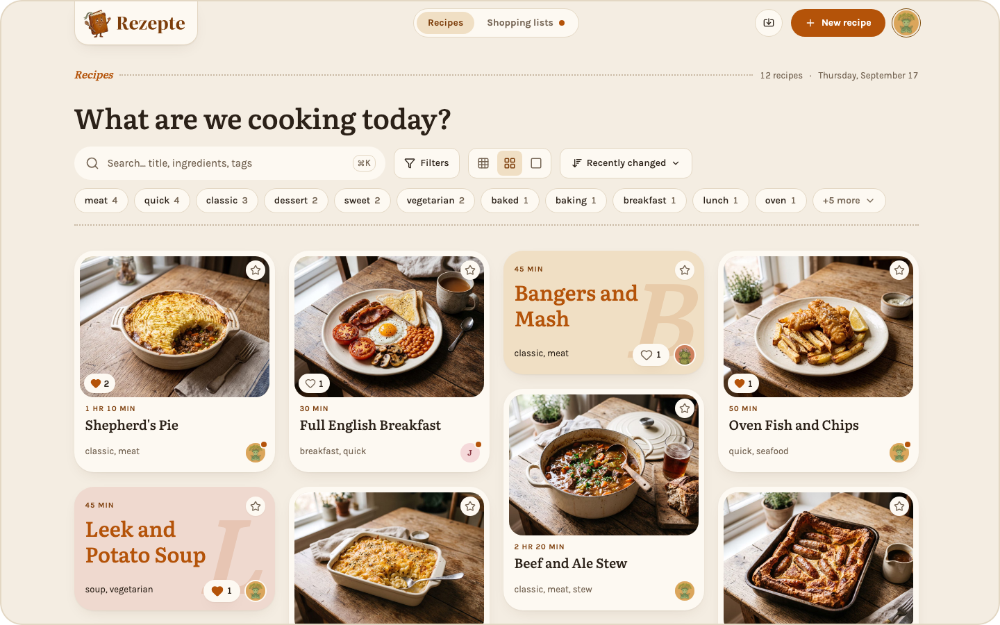
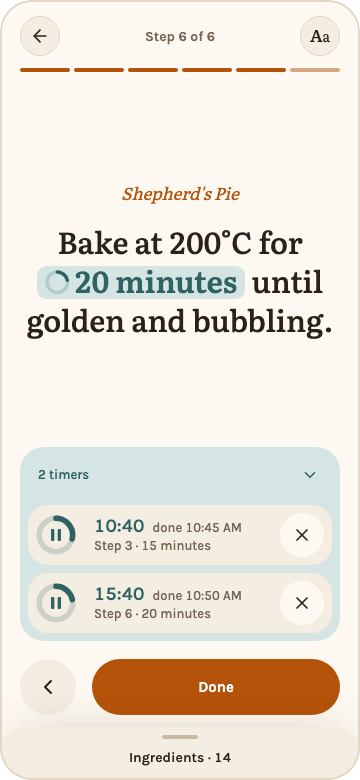

<div align="center">

<a href="https://getrezepte.app/"></a>

# Rezepte

**Your recipes. Your kitchen. Your server.**<br>
A self-hosted recipe manager that keeps everyone's recipes in one app, cooks along step by step, plans the week and writes the shopping list.

[](https://github.com/s-frei/rezepte/actions/workflows/ci.yml)
[](https://github.com/s-frei/rezepte/releases/latest)
[](https://getrezepte.app/)
[](LICENSE)

**[Documentation](https://getrezepte.app/)** · [Try the demo](#try-it) · [Install](https://getrezepte.app/getting-started/) · [Feature tour](https://getrezepte.app/guide/) · [Changelog](https://getrezepte.app/changelog/) · [API](https://getrezepte.app/api/) · [Roadmap](https://getrezepte.app/roadmap/)

<a href="https://getrezepte.app/guide/tags-and-search/"><picture>
  <source media="(prefers-color-scheme: dark)" srcset="assets/readme/overview-desktop-dark.png">
  
</picture></a>
<a href="https://getrezepte.app/guide/cook-mode/"><picture>
  <source media="(prefers-color-scheme: dark)" srcset="assets/readme/cook-mode-timers-mobile-dark.png">
  
</picture></a>

<sub>Left: <a href="https://getrezepte.app/guide/tags-and-search/">find a recipe by tag, ingredient or time</a>. Right: <a href="https://getrezepte.app/guide/cook-mode/">cook mode</a> with timers running side by side. <a href="https://getrezepte.app/#tour">Watch the 30-second tour</a>.</sub>

</div>

*Rezepte* is German for "recipes". It runs as **one binary** with the web app built in, an SQLite database and your photos in a single data directory: no Node runtime, no database server, no external services.

## Try it

Demo mode fills an empty instance with twelve sample recipes and a small household, so you can click through the real app:

```bash
docker run --rm -p 8060:8060 ghcr.io/s-frei/rezepte:latest --demo
```

Open <http://localhost:8060> and log in as **`demo`** / **`demo1234`**. The log prints the other logins too.

> [!NOTE]
> Nothing is kept: there is no volume, and `--rm` removes the container when it stops. To keep what you write, [run your own instance](#run-your-own-instance).

## Run your own instance

Compose is the setup Rezepte is meant to be run with. Save this as `docker-compose.yaml`, choose your own owner password, and start it with `docker compose up -d`:

```yaml
services:
  rezepte:
    image: ghcr.io/s-frei/rezepte:latest
    restart: unless-stopped
    volumes:
      - rezepte-data:/data
    environment:
      REZEPTE_ADMIN_PASSWORD: change-me-now
      # The time zone the times in mails are written in; UTC without it.
      # TZ: Europe/Berlin
    ports:
      - "8060:8060"

volumes:
  rezepte-data:
```

Open <http://localhost:8060> and log in as **`admin`** with the password you set. That account owns the instance. There is no self-registration, so invite everyone else from the settings once you are in.

> [!IMPORTANT]
> `REZEPTE_ADMIN_PASSWORD` is read only on the very first start, to create the owner. Afterwards, change the password inside the app; the variable is read again only by `--reset-superadmin-password`.

Before you invite anyone, put Rezepte behind a [reverse proxy with HTTPS](https://getrezepte.app/operations/reverse-proxy/): installing the app, push notifications, timer alarms and the screen that stays on only work over HTTPS.

`latest` is the newest stable release. Every version is on the [releases page](https://github.com/s-frei/rezepte/releases), and every image tag on the [package page](https://github.com/s-frei/rezepte/pkgs/container/rezepte). [Getting started](https://getrezepte.app/getting-started/) covers plain `docker run`, the binary with systemd, and every setting.

## Features

- 🍳 **[Cook mode](https://getrezepte.app/guide/cook-mode/):** one step at a time in large type, with the amounts it uses, [times that start a timer](https://getrezepte.app/guide/cook-mode/#run-timers) with a tap and notify you on a locked phone, and quantities [scaled to your servings](https://getrezepte.app/guide/servings/).
- 📝 **[Recipes](https://getrezepte.app/guide/recipes/):** ingredient groups, notes, times, [several photos](https://getrezepte.app/guide/images/) and [comments](https://getrezepte.app/guide/comments/), found again [by text, tag, time or what you have at home](https://getrezepte.app/guide/tags-and-search/).
- 📥 **[Import](https://getrezepte.app/guide/importing/):** paste a link or the recipe text and check the draft, or let any AI chat [write the recipe](https://getrezepte.app/guide/text-format/) and paste the answer back.
- 🛒 **[Shopping lists](https://getrezepte.app/guide/shopping-lists/):** filled from recipes, sorted by store department, the same ingredient added up into one row, [shared](https://getrezepte.app/guide/shopping-lists/#share-a-list) and [ticked off live](https://getrezepte.app/guide/shopping-lists/#live) on every screen.
- 🗓️ **[Meal plan](https://getrezepte.app/guide/meal-plan/):** recipes and notes on the days of a week, alone or [shared](https://getrezepte.app/guide/meal-plan/#share-a-plan). [The week goes on a list](https://getrezepte.app/guide/meal-plan/#put-it-on-a-shopping-list) in one go and keeps following the plan, and [your calendar app shows it](https://getrezepte.app/guide/meal-plan/#show-the-plan-in-your-calendar).
- 📱 **[An app on your phone](https://getrezepte.app/guide/install-app/):** install it on the home screen or desktop, no app store.
- 👥 **[People](https://getrezepte.app/guide/users/):** invitation by setup link, [sent by mail](https://getrezepte.app/guide/mail/) if you like, [one shared kitchen tablet](https://getrezepte.app/guide/settings/#share-a-device), [who may edit](https://getrezepte.app/guide/editing-rights/), [sign-in with Google or your own OIDC provider](https://getrezepte.app/operations/single-sign-on/), and [notifications](https://getrezepte.app/guide/notifications/) by mail or push.
- 🔗 **[Sharing](https://getrezepte.app/guide/sharing/):** a link for people with an account, a [public link](https://getrezepte.app/guide/sharing/#public-links) that expires when you say, or [an image for any messenger](https://getrezepte.app/guide/sharing/#pass-on-as-an-image), and [printed as a cookbook page or card or saved as a PDF](https://getrezepte.app/guide/printing/).
- 🔌 **Your data:** [zip export and import](https://getrezepte.app/guide/import-export/), an [HTTP API](https://getrezepte.app/api/) with [scoped tokens](https://getrezepte.app/api/tokens/), and an [MCP server](https://getrezepte.app/api/mcp/) through which AI assistants read and edit recipes, plans and lists.

English and German are built in, and every member picks their own. Missing your language? [Adding one](https://getrezepte.app/contributing/add-a-language/) takes four files and no programming.

## Coming from Mealie, Tandoor or Paprika?

They are mature apps, and Rezepte is younger and smaller. Here is what it does well:

- **A modern interface made for the phone.** Cook mode, a bottom bar and the command palette are part of the design from the start, not added later.
- **AI assistants built in.** Any AI chat writes recipes that paste in complete, an MCP server lets assistants work on them directly, and API tokens are scoped per area, from read-only to delete.
- **Little to run.** No database server or runtime to look after, and an Apache 2.0 license.

What it does not do yet: import from other apps, convert units, or show nutrition. If you need those today, Mealie and Tandoor do them well.

> [!TIP]
> None of these are ruled out, and I am open to anything that helps people cook. If you are missing something, [share the idea in Discussions](https://github.com/s-frei/rezepte/discussions/categories/ideas) and tell me what you need.

## What to expect

- **Stable since 1.0.** Rezepte follows [semantic versioning](https://semver.org): only a major version brings breaking changes, and such a release says so at the top of its [changelog](https://getrezepte.app/changelog/) page.
- **Your data stays yours.** Everything lives in one directory: an SQLite database and plain JPEG files. [Back up the whole directory](https://getrezepte.app/operations/data-and-backup/) before every update, and use [zip export](https://getrezepte.app/guide/import-export/) to move recipes to another instance.
- **One maintainer.** I built Rezepte because I needed it myself. Issues get read, but there is no support guarantee.
- **Developed AI-driven.** Most of the code and all of the documentation is written by AI coding agents, working against the guidelines and the agent memory in this repository, and reviewed and steered by me. It is an experiment as much as a workflow, and a good part of why I enjoy building this.

## Documentation

Everything lives at **[getrezepte.app](https://getrezepte.app/)**:

| Page | What you find there |
| --- | --- |
| [Getting started](https://getrezepte.app/getting-started/) | Run Rezepte with Docker or as a binary, and log in for the first time. |
| [Tour of the app](https://getrezepte.app/guide/) | Every feature, with screenshots. |
| [Operations](https://getrezepte.app/operations/data-and-backup/) | Where the data lives, backups, updates, reverse proxies and [single sign-on](https://getrezepte.app/operations/single-sign-on/). |
| [API](https://getrezepte.app/api/) | The HTTP API behind the app, with a generated reference, and the MCP server for AI assistants. |
| [Changelog](https://getrezepte.app/changelog/) | What changed in each release, and what to do before you update. |
| [Roadmap](https://getrezepte.app/roadmap/) | Where Rezepte could go next. |
| [Contributing](https://getrezepte.app/contributing/add-a-language/) | Translate the interface into another language. |

AI assistants can read the whole manual too: [`/llms.txt`](https://getrezepte.app/llms.txt) indexes it and [`/llms-full.txt`](https://getrezepte.app/llms-full.txt) is all of it in one file.

## Development

The stack is a Go service serving a bundled SvelteKit SPA, with SQLite for storage. Every tool is pinned, and every task runs through [mise](https://mise.jdx.dev):

```bash
mise trust && mise install && mise run setup   # tools and dependencies
mise run dev                                   # app on :9060, API on :8060
mise run check                                 # every lint, format and test gate
```

`mise run dev` creates a local `admin` / `admin1234` login on first start and prints it.

The long-form developer documentation (architecture, conventions and how-tos) lives in the repository under [`docs/memory/content/`](docs/memory/content/) and is not published.

## Contributing

Contributions are welcome: [CONTRIBUTING.md](CONTRIBUTING.md) says where a bug, an idea or a pull request goes. A translation is the easiest way in and needs no code: [Add a language](https://getrezepte.app/contributing/add-a-language/).

## License

[Apache License 2.0](LICENSE)
