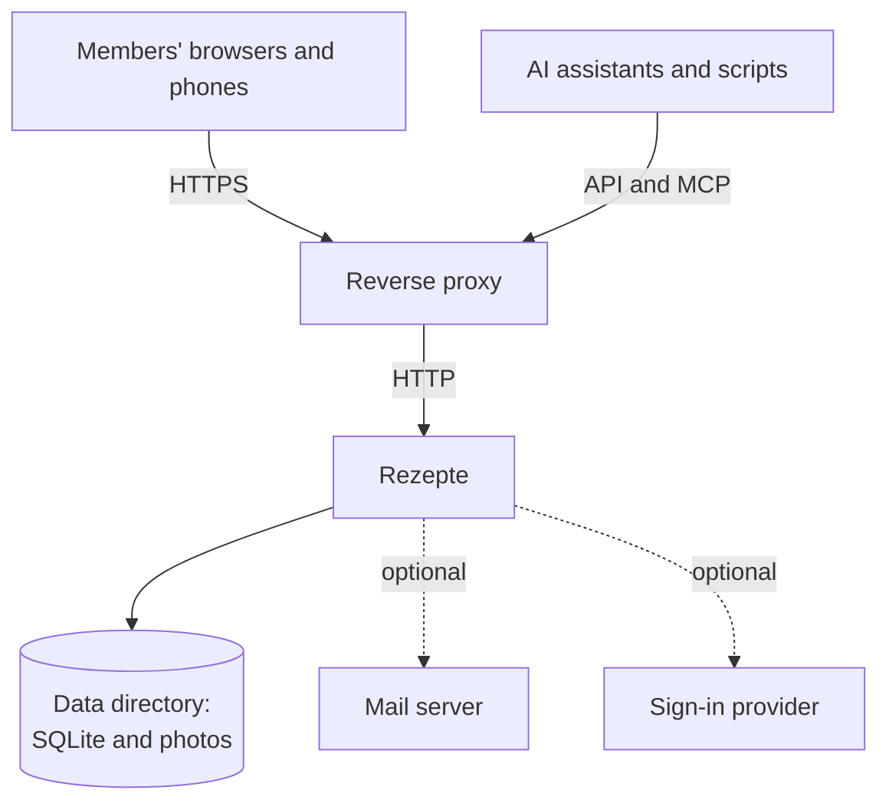

Get a household instance running in a few minutes with Docker Compose. For other ways to run it, see [Docker](/getting-started/docker) and [Running the binary](/getting-started/binary).

<Steps>
  <Step>

    ### Start it

    Save this as `docker-compose.yaml` and run `docker compose up -d`. To run another version, see [image tags](/getting-started/docker#image-tags).

    <include lang="yaml" meta='title="docker-compose.yaml"'>../../../../../docker-compose.yaml#compose</include>

  </Step>
  <Step>

    ### Open the app

    Visit `http://localhost:8060` in a browser.

  </Step>
  <Step>

    ### Log in

    Log in as `admin` with the password from `REZEPTE_ADMIN_PASSWORD` in the compose file. Then change it in the app, as [First login](/getting-started/first-login) shows.

  </Step>
  <Step>

    ### Create the first recipe

    Click "New recipe" and save it. See [Recipes](/guide/recipes) for the editor.

  </Step>
</Steps>

<Callout type="warn">
  `REZEPTE_ADMIN_PASSWORD` is read only on the first start. Editing it later changes no password on its own.
</Callout>

<Callout type="info" title="Try it without setup">
  Run `docker run --rm -p 8060:8060 ghcr.io/s-frei/rezepte:latest --demo` and log in as `demo` / `demo1234`. The sample data is gone when the container stops; see [demo mode](/getting-started/configuration#--demo).
</Callout>

## How it fits together

Before you invite anyone, add a [reverse proxy](/operations/reverse-proxy) for HTTPS. Everything Rezepte keeps is in one [data directory](/operations/data-and-backup). [Mail](/guide/mail) and a [sign-in provider](/operations/single-sign-on) are optional.
