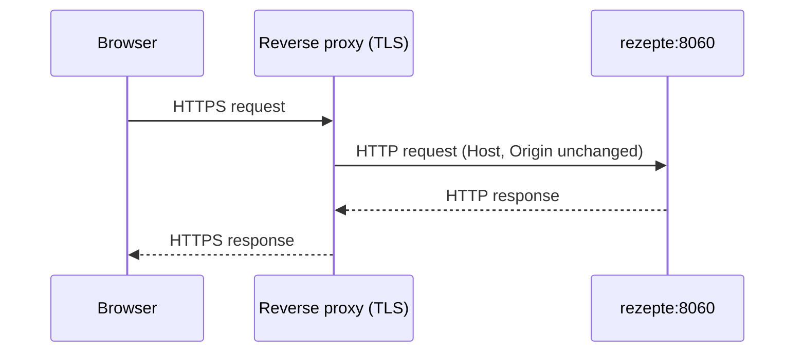

import { NewIn } from '@/components/new-in';

Rezepte itself only speaks plain HTTP. Terminate TLS at a reverse proxy in front of it and forward everything to its port (8060 by default). Browsers keep several features to secure addresses, so over plain HTTP (other than `localhost`) members get no [installable app](/guide/install-app), no screen that stays on in [cook mode](/guide/cook-mode) or [shopping mode](/guide/shopping-lists#shopping-mode), and no push notifications: neither when a timer ends while Rezepte is in the background nor the [notifications](/guide/notifications) about comments, new recipes and the rest.



<Tabs items={['Caddy', 'nginx']}>
  <Tab value="Caddy">

    ```text title="Caddyfile"
    rezepte.example.com {
      reverse_proxy localhost:8060
    }
    ```

    Caddy forwards `Host` and `Origin` unchanged and provisions TLS automatically. It sets no limit on the size of a request by default, so photo uploads need nothing extra.

  </Tab>
  <Tab value="nginx">

    ```nginx
    location / {
      proxy_pass http://127.0.0.1:8060;
      proxy_set_header Host $host;
      proxy_set_header Origin $http_origin;
      client_max_body_size 10m;
    }
    ```

    ```nginx
    location ~ ^/api/v1/shopping-lists/[^/]+/events$ {
      proxy_pass http://127.0.0.1:8060;
      proxy_set_header Host $host;
      proxy_set_header Origin $http_origin;
      proxy_buffering off;
      proxy_read_timeout 1h;
    }
    ```

    The second block is for [live shopping lists](#live-lists). `client_max_body_size` matches Rezepte's own limit of 10 MiB per photo upload. nginx's default is 1 MB, which turns away most photos from a phone camera with `413 Request Entity Too Large` before they reach Rezepte.

  </Tab>
</Tabs>

<Callout type="warn">
  The proxy must forward the `Host` and `Origin` headers unchanged. The API rejects a mutating request (`POST`/`PUT`/`PATCH`/`DELETE`) whose `Origin` header names a different host than the request's `Host` — this is what stops cross-site requests from acting on a logged-in session. A proxy that rewrites either header, or that terminates TLS without passing the original `Host` through, will lock the app's own login and editing out.
</Callout>

Once the app is reachable over HTTPS, set `REZEPTE_SECURE_COOKIES=true` so the session cookie gets the `Secure` attribute (see [Configuration](/getting-started/configuration)). It also tells Rezepte to link its preview image over `https`, so a link shared in a chat app shows the Rezepte logo.

## Live lists<NewIn release="v1.4.0" />

An open [shopping list](/guide/shopping-lists#live) holds one long-lived response, `/api/v1/shopping-lists/<id>/events`, that Rezepte writes to whenever the list changes and every 25 seconds otherwise. The proxy must pass it on as it arrives instead of collecting it. Rezepte marks that response with `X-Accel-Buffering: no`, which nginx follows unless `proxy_ignore_headers` tells it otherwise, and nginx's default `proxy_read_timeout` of 60 seconds is above the 25-second heartbeat, so an nginx setup from before shopping lists already works; the second block above writes the same into the configuration, so it no longer depends on that header. Caddy and Traefik stream by default and need nothing.

Browsers allow six connections per host over HTTP/1.1, and every open list tab holds one. Serving the browser over HTTP/2, which Caddy does automatically and nginx does with `http2 on;` beside `listen 443 ssl;`, lifts that limit.
